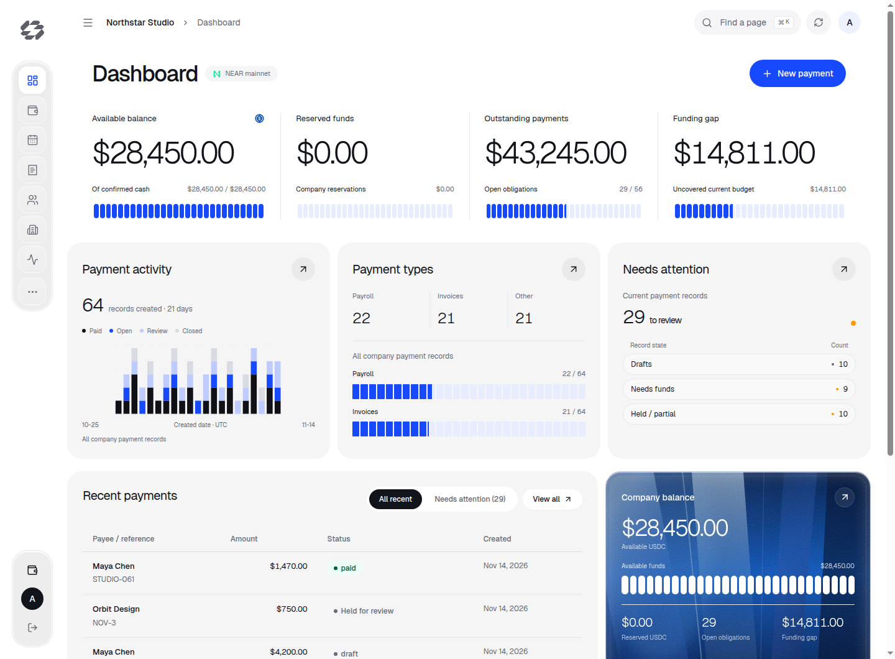
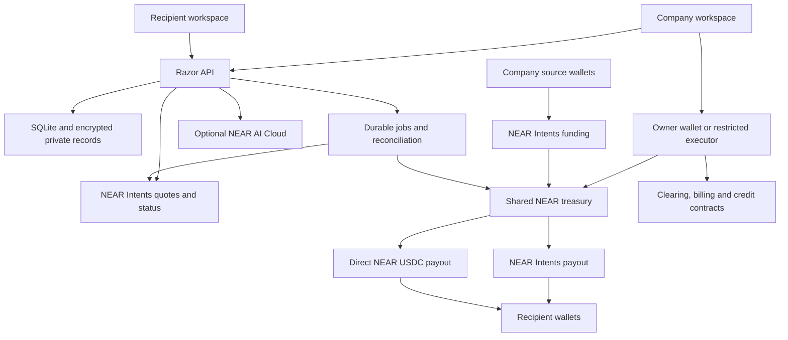

<p align="center"></p>

<h1 align="center">Razor</h1>

<p align="center"><strong>Run your company's money. Beyond borders.</strong></p>

<p align="center">Treasury, payroll, invoices and cross-chain business payments. One workspace, powered by NEAR.</p>

<p align="center">
  <a href="https://razorfi.xyz">Website</a> |
  <a href="https://razorfi.xyz/app">Company workspace</a> |
  <a href="https://razorfi.xyz/receive">Recipient workspace</a> |
  <a href="https://razorfi.xyz/demo">Product preview</a> |
  <a href="docs/README.md">Documentation</a>
</p>

Razor gives companies one place to manage crypto-funded operations: paying employees, contractors and suppliers, collecting invoices, coordinating approvals and reconciling what actually arrived. Companies record obligations in USDC, fund through supported assets and networks, and pay people in their confirmed asset of choice through NEAR Intents.

The company controls its payment policy. The recipient controls their receiving preferences. Razor connects both sides to a shared financial record, including fees, approvals, delivery, refunds and unresolved transfers.

<p align="center"></p>
<p align="center"><sub>Product interface with fictional example company data.</sub></p>

## What makes Razor different

- **A company finance workspace.** Payroll, supplier bills, treasury, expenses and accounting share the same obligations and payment history.
- **Flexible funding and receiving.** A company can fund through multiple supported assets while each recipient chooses their own supported payout asset and network.
- **Recovery built into the payment.** A consented native USDC backup helps when a primary route is unavailable. An uncertain transfer stays held until reconciled, preventing a retry from paying twice.
- **Less money moving between businesses.** Consenting companies can offset accepted invoices or fund only their net positions through NEAR clearing escrow.
- **Revenue from software.** Razor adds no percentage markup to payment principal. Optional company subscriptions pay for workflow capacity and automation.

## Product capabilities

| Area | What companies and recipients can do |
| --- | --- |
| Onboarding and access | Sign in with a wallet or configured Google/email login, create a company, invite finance teammates, switch companies and link a separate NEAR owner wallet |
| Treasury | Activate an isolated company ledger in the shared NEAR contract, fund through independent supported-asset deposits, inspect available and reserved funds, and withdraw eligible balances |
| Payroll | Import CSV pay runs, record base pay, bonuses and adjustments, review funding needs, approve batches and schedule recurring obligations in the company's time zone |
| Invoices and collections | Create payment requests and funding links, review supplier invoices, manage milestones, installments, credits and disputes, and track outstanding liabilities |
| Recipient workspace | Manage separate payer-company profiles, confirm primary and native USDC backup destinations, submit invoices and expenses, and follow personal payment records |
| Payment controls | Set roles, approval thresholds, per-payment and daily limits, exact recipient terms, execution-cost ceilings, pauses and revocable standing authority |
| Recovery | Reconcile uncertain transfers, inspect partial delivery, approve only the remaining obligation and track source refunds without creating duplicate cash credits |
| Business clearing | Propose invoice offsets or cash-backed rounds, collect each company's exact consent, settle net positions and preserve creditor or refund withdrawal rights |
| Expenses and purchasing | Manage purchase requests, supplier commitments, tenders, expense claims, reimbursements and returned expenses |
| Projects and accounting | Track cost centers, client reserves and project cash flows; export reconciled records; connect configured QuickBooks, Xero or restricted NetSuite integrations |
| Private AI and agreements | Optionally process financial documents through NEAR AI Cloud, inspect verification evidence, retain encrypted proposals and review drafts before payment approval |
| Working capital | Use an optional native USDC credit escrow for agreed lender offers, advances, repayment and collateral accounting when eligible lenders and service scope are configured |
| Integrations and operations | Use scoped APIs and MCP tools, signed events, payment monitoring, in-app notifications and optional email delivery |

These workflows have different activation needs. Clearing, lending, paid subscriptions and private AI are optional; a company can use ordinary payments without enabling them. This release covers crypto payments, not local-currency bank payouts, statutory payroll or tax filing.

## How a payment works

1. **Create the workspace.** Set up the company, invite the finance team and link its NEAR treasury owner. Application login and financial signing authority remain separate.
2. **Confirm the recipient.** The employee, contractor or supplier confirms a supported asset, network and address, plus an explicitly consented native USDC backup.
3. **Prepare the obligation.** Create an invoice payment or payroll run in USDC, with the required approvals and execution-cost ceiling.
4. **Fund it.** Use supported source assets through NEAR Intents or native NEAR USDC. Multiple funding legs are tracked independently; only verified, company-attributed treasury deposits become spendable cash.
5. **Review and authorize.** Inspect the exact route and receiving terms. Owner-authorized execution must satisfy the company's contract-enforced policy and budget.
6. **Reconcile both sides.** The company sees the payment outcome and accounting record; the recipient sees their own receipt. Uncertain, partial and refunded outcomes retain distinct recovery paths.

Asset availability comes from the live Intents catalog and the current quote. A listed token does not guarantee a route at every amount or time. See [payouts and fallback](docs/specs/payouts-and-fallback.md).

## Business clearing: settle the difference

Suppose Company A owes Company B **100 USDC**, and B owes A **70 USDC**. Paying both invoices separately moves 170 USDC. With both owners' consent, a cash-backed Razor clearing round instead requires A to fund **30 USDC** and gives B a fixed **30 USDC** withdrawal right.

The contract verifies the agreed invoices, company identities, consents and complete funding before finalization. Accounting records distinguish **170 USDC of invoice discharge** from **30 USDC of net funded principal**. A creditor withdrawal is recorded as delivered only after its token callback succeeds.

Pure invoice cycles can also use noncash setoff. Employee wages and personal contractor payments never enter business clearing. Read the [clearing design](docs/specs/business-clearing.md) and [cash-backed settlement rules](docs/specs/funded-business-clearing.md).

## Why NEAR

| NEAR component | Its role in Razor |
| --- | --- |
| NEAR accounts and Rust contracts | Company authority, isolated balances, approvals, spending limits, exact payment attempts and recovery state |
| NEAR Intents | Supported cross-chain funding and payouts, live asset discovery, route quotes and transfer status |
| Native NEAR USDC | Company settlement balances, direct payouts, clearing escrow, subscription checkout and optional credit escrow |
| Restricted function-call keys | Bounded execution under owner-granted authority; token budgets are enforced in contract logic, not inferred from a key's gas allowance |
| NEAR AI Cloud | Optional private financial-document inference with verification checks and human review |
| Stateless evidence contract | Optional immutable timing commitments for the private-evidence verification workflow |

Company registration adds state to one shared treasury rather than deploying another copy of its code. Companies still need the quoted state allowance and transaction gas. External chains are funding and receiving endpoints; Razor's financial authority is built on NEAR.

The primary hackathon fit is **Real-World Money**, with additional automation, private AI and security work mapped in [NEAR track alignment](docs/specs/near-track-alignment.md).

## Architecture



The application uses Next.js, React, TypeScript, Hono and SQLite. Contracts use Rust and the NEAR SDK. Wallet integration uses NEAR Connect, optional Privy and chain-specific libraries; token and network identities use Web3 Icons. The background worker handles durable jobs and reconciliation, with financial execution available only under separately configured company authority.

## Mainnet deployment

The hosted application is available at [razorfi.xyz](https://razorfi.xyz). Five Razor contracts were deployed and verified on **NEAR mainnet on 14 November 2026**.

| Contract | Mainnet account | Responsibility |
| --- | --- | --- |
| Treasury | [treasury.shreyassp002.near](https://nearblocks.io/address/treasury.shreyassp002.near) | Company ledgers, funding, payment policy and recovery |
| Clearing | [clearing.shreyassp002.near](https://nearblocks.io/address/clearing.shreyassp002.near) | Consented invoice setoff and cash-backed rounds |
| Billing | [billing.shreyassp002.near](https://nearblocks.io/address/billing.shreyassp002.near) | Explicit company subscription payments |
| Credit | [credit.shreyassp002.near](https://nearblocks.io/address/credit.shreyassp002.near) | Optional native USDC lending escrow |
| Evidence | [evidence.shreyassp002.near](https://nearblocks.io/address/evidence.shreyassp002.near) | Optional stateless evidence commitments |

The [deployment record](docs/deployments/mainnet-2026-11-14.md) contains transaction links, reviewed code hashes, token registrations and verified reserve recovery. Treasury, clearing, billing and credit retain operator-controlled upgrade keys; the evidence contract is keyless and immutable. An upgrade key can replace money-handling code, so company-level permissions do not remove that operator trust.

Deployment verification is separate from customer settlement evidence. The product preview and recorded walkthrough use fictional local records; they do not establish completed mainnet payroll, paid subscriptions, funded loans or verified private inference. See the [build checklist](docs/build-checklist.md) and [software coverage](docs/specs/software-coverage.md) for implementation and verification scope.

## Fees and business model

**Razor charges 0% platform markup on payment principal.** Network, storage, conversion and quoted execution costs remain separate and visible. Subscriptions are explicit company purchases; they are never deducted from employee or contractor entitlements.

| Plan | Monthly price | Intended use |
| --- | --- | --- |
| Free | 0 USDC | Recipient access, manual company payments and a small finance team |
| Pro | 29 USDC per workspace | Batch payroll, recurring workflows, clearing proposals and additional team and AI capacity |
| Business | 99 USDC per workspace | Greater team and AI capacity for larger finance operations |

These are versioned pilot offers. Default pilot mode provides bounded complimentary Pro access; enforced billing requires confirmed subscription payment. Withdrawal, recovery and access to existing records remain available regardless of plan. See the [business model](docs/specs/business-model.md) and [billing operations](docs/billing-operations.md).

## Run locally

Use **Node.js 24.22.1 or later**. The repository pins a version in `.nvmrc`.

```sh
nvm install
nvm use
npm ci
cp .env.example .env.local
npm run dev
```

Open `http://localhost:3000`. Set `APP_URL` to the exact browser origin. The regular application starts with sign-in and company creation; it has no seeded administrator or funded balance. Wallet login works without Privy credentials. Google and email login require the matching Privy configuration.

SQLite migrations run automatically into `.data/razor.sqlite`. Production requires persistent disk and a 32-byte `DATA_ENCRYPTION_KEY` in hex or base64. Back up the database and its original encryption key together; development creates a private local key when none is configured.

Check configuration before enabling optional integrations:

```sh
npm run check:setup
npm run check:setup -- --remote
```

The remote check reads network and contract configuration without signing transactions. The [operator guide](docs/operator-setup.md) covers NEAR code and key pins, Privy, Intents, private AI, accounting providers and email. Missing optional providers leave their features unavailable.

Run `npm run worker` in another terminal when background processing is needed. Configure company execution authority before enabling automated payments; the worker can execute already authorized due routes. NEAR Intents settlement uses mainnet, while contract-only development can use testnet with an explicitly configured test token.

### Explore without funds

The public [product preview](https://razorfi.xyz/demo) is read-only and needs no wallet. For an interactive local recording workspace, keep the UI running on port 3000 and start:

```sh
npm run demo:local
```

Open `http://localhost:3400/__demo` for the isolated sandbox controls. It uses fictional companies and an in-memory database, blocks external calls and never broadcasts transactions. See the [local demo guide](scripts/demo/README.md) and [recording kit](scripts/demo-film/README.md) for reproducible captures, Sarah narration, visible cursor motion and synchronized captions.

### Build and verify

```sh
npm run typecheck
npm test
npm run build
```

Run checks serially and stop development servers before a production build. The build guard caps memory, serializes builds and limits Next.js workers. Rust builds use one job. For contract compilation, install the Rust `wasm32-unknown-unknown` target and Binaryen `wasm-opt` 130, then follow the [contract guide](contracts/README.md). Compiled artifacts stay outside Git.

## Repository structure

```text
src/
  app/              Website, company and recipient routes, API entry point
  components/       Finance workflows, account controls and shared UI
  lib/              Shared types, exact amounts, wallets and verification helpers
  server/           Business services, API, persistence and integrations
contracts/          NEAR treasury, clearing, billing, credit and evidence source
scripts/            Worker, operator tools, build guards and local demo tooling
tests/              Application, authorization and financial workflow checks
public/             Branding, fonts and product artwork
deploy/             Caddy and systemd hosting templates
docs/               Product specifications, checklists and deployment records
```

## Further reading

- [Product overview](docs/specs/product-overview.md) and [feature specification](docs/specs/features.md)
- [Contract architecture and authority](contracts/README.md)
- [Payment fallback and recovery](docs/specs/payouts-and-fallback.md)
- [Private inference and verification](docs/specs/private-inference.md)
- [Security review](docs/security-review.md) and [dependency review](docs/specs/dependency-security.md)
- [Mainnet deployment](docs/deployments/mainnet-2026-11-14.md) and [hosting operations](docs/deployments/aws-2026-11-15.md)
- [Third-party source acknowledgments](THIRD_PARTY_NOTICES.md)

Private document processing does not make public-chain transfers private. Cross-chain delivery records distinguish provider observations, authorized attestations and independent chain evidence; an authorized report is not a cryptographic proof of external-chain delivery. The technical guides describe these trust boundaries in detail.
